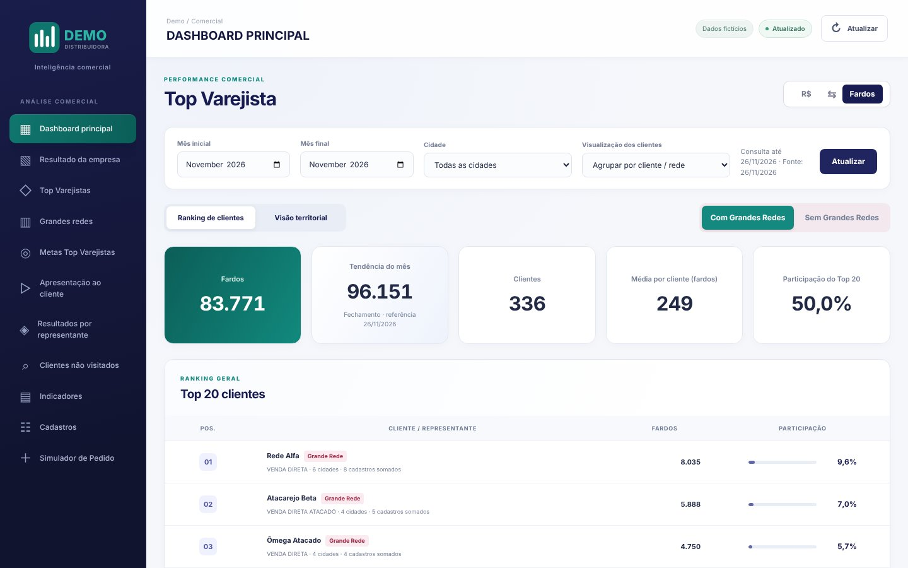
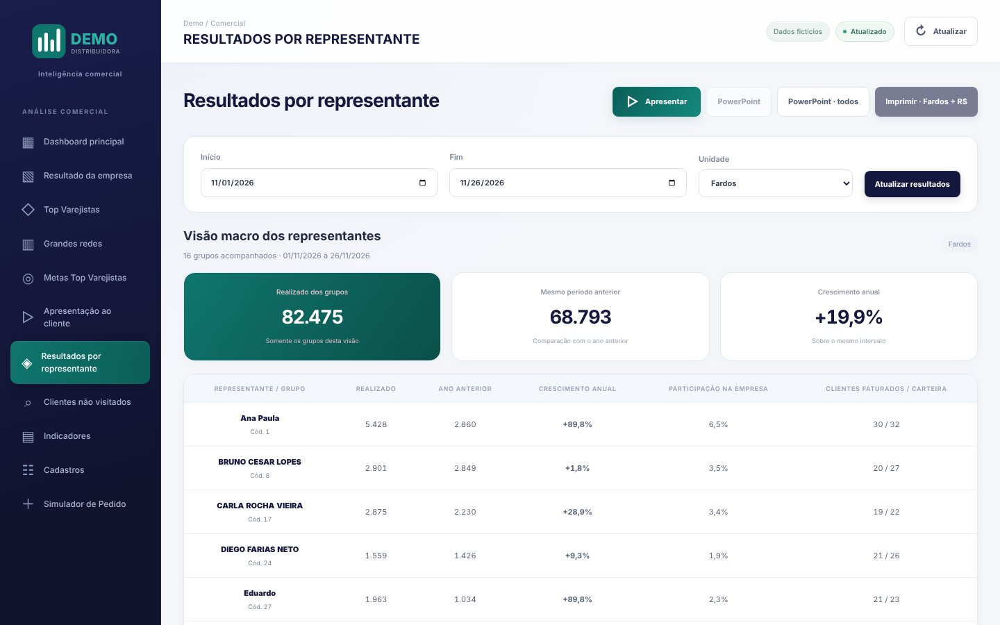
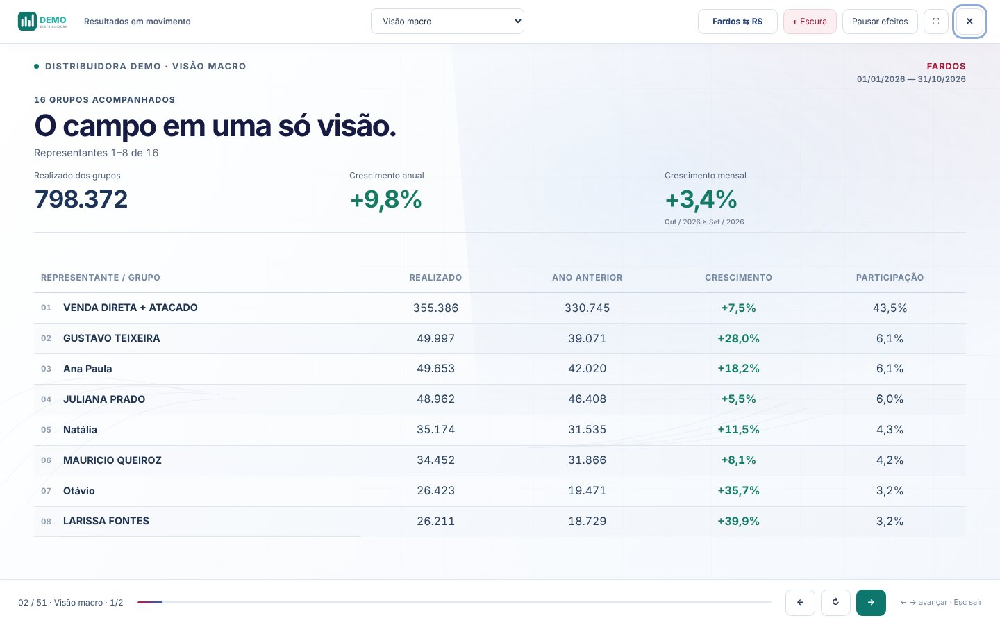

# BI Comercial · Demo

Versão de demonstração de uma plataforma de **inteligência comercial** que desenvolvi e uso no dia a dia da área comercial de uma indústria de alimentos. Ela reúne num só lugar o acompanhamento de vendas, metas, grandes redes, resultados por representante e apresentações para reuniões com clientes e com a equipe.

**[Abrir a demonstração](https://lucascarreiro.github.io/bi-comercial-demo/)**

> **Todos os dados desta versão são fictícios.** Empresa, clientes, representantes, redes, produtos, preços, telefones e endereços foram inventados e são gerados no próprio navegador por [`public/js/demo-api.js`](public/js/demo-api.js). As cidades são municípios reais apenas para que o mapa (malhas do IBGE) funcione.



## Módulos

| Módulo | O que faz |
|---|---|
| **Dashboard principal** | Volume em fardos ou R$, tendência do mês, ranking dos clientes (com e sem grandes redes), mix por categoria e visão territorial por município |
| **Resultado da empresa** | Evolução mensal e anual com comparação no mesmo intervalo do ano anterior e filtro por datas exatas |
| **Top Varejistas e Grandes redes** | Acompanhamento dos participantes do programa e das redes, com tendência até dezembro |
| **Metas Top Varejistas** | Metas mensais por participante e categoria. Cada categoria atingida aumenta 10% no mês seguinte. |
| **Apresentação ao cliente** | Relatório individual para reunião, com modo de impressão / PDF |
| **Resultados por representante** | Visão macro da equipe, carteira com e sem faturamento, mapa por município, clientes a recuperar, exportação para **PowerPoint** e **apresentação animada** navegável pelo teclado |
| **Clientes não visitados** | Cruza a base de clientes com o faturamento do período para achar quem não comprou |
| **Indicadores** | Redes × Representantes, ranking e pedidos em aberto, consultando a API dia a dia |
| **Cadastros** | Participantes, redes, agrupamentos de clientes e apelidos de representantes, com controle de revisão |
| **Simulador de Pedido** | Negociação com desconto progressivo no arroz, financiado pela margem de outros produtos |



## Destaques técnicos

- **JavaScript puro, sem framework.** Os módulos ES viram scripts clássicos por um build próprio e sem dependências ([`build_browser.mjs`](build_browser.mjs)). O servidor não precisa de Node.
- **PHP 8 como camada de servidor**: um proxy para a API comercial que valida período, formato e duplicidades, e a gravação dos cadastros em JSON com revisão, *lock* de arquivo e escrita atômica para que dois usuários não sobrescrevam alterações um do outro.
- **Projeções transparentes**: a tendência por categoria usa Theil–Sen nos últimos meses fechados. Meses sem dados nunca viram zero, e a projeção nunca fica abaixo do já realizado.
- **Regras de negócio explícitas**: "Outros" entra nos totais mas não pontua nos rankings, um cliente específico fica fora das análises, agrupamentos unem cadastros do mesmo cliente sem transformá-lo em grande rede, e os meses parciais são comparados com o mesmo corte de dias.
- **Mapas em SVG** gerados a partir das malhas municipais do IBGE, sem serviço externo.
- **Exportações no navegador**: PowerPoint com [PptxGenJS](https://gitbrent.github.io/PptxGenJS/), impressão A4 em fardos e R$, e apresentação com animações ([Motion](https://motion.dev/)) que respeitam a preferência por movimento reduzido.



## Como funciona o modo demonstração

O arquivo [`public/js/demo-api.js`](public/js/demo-api.js) intercepta as chamadas para `api/*.php` e responde com dados gerados na hora:

- **Gerador determinístico** (semente fixa): a mesma consulta sempre devolve os mesmos números, de janeiro de 2024 até hoje.
- Cerca de 440 clientes fictícios, 19 representantes e 6 redes, com sazonalidade, crescimento diferente por representante, clientes novos, clientes que pararam de comprar e pedidos em aberto.
- Cadastros e metas salvos na demonstração ficam só no seu navegador (`localStorage`).

Para regenerar a base de clientes e as sementes JSON a partir do gerador:

```bash
node gerar-dados-demo.mjs
node build_browser.mjs
```

## Como rodar

Qualquer servidor estático serve:

```bash
cd public
python -m http.server 8000
# abra http://localhost:8000
```

### Com a API real (modo servidor)

1. Hospede a pasta `public/` num servidor com **PHP 8**.
2. Copie `public/api/config.example.php` para `public/api/config.php` e informe o endereço da sua API.
3. Retire a linha `<script src="js/demo-api.js"></script>` de `index.html`, `apps/dashboard/index.html` e `apps/indicadores/index.html`.
4. Garanta que o PHP pode gravar em `public/data/`.

## Estrutura

```
public/
  index.html            portal (menu lateral e telas)
  js/                   módulos-fonte + bundles gerados
  js/demo-api.js        API fictícia do modo demonstração
  css/                  estilos do portal, relatórios e apresentações
  apps/dashboard/       dashboard principal e mapa territorial
  apps/indicadores/     relatório Redes × Representantes
  apps/simulador-top/   simulador de pedido
  api/                  endpoints PHP (proxy da API e gravação em JSON)
  assets/               logo fictício, malhas do IBGE e bibliotecas
build_browser.mjs       gera os bundles a partir dos módulos
gerar-dados-demo.mjs    gera a base fictícia de clientes e as sementes
```

## Créditos

Malhas municipais: [IBGE](https://servicodados.ibge.gov.br/api/docs/malhas). Bibliotecas incluídas com as licenças em `public/assets/vendor/`: Motion (MIT), PptxGenJS (MIT) e JSZip (MIT ou GPLv3).

---

Feito por **Lucas Carreiro** · [LinkedIn](https://www.linkedin.com/in/lucas1carreiro1/)
